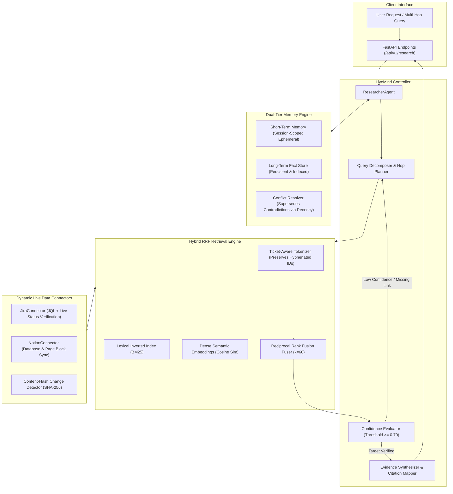

<div align="center">

# 🧠 LiveMind

### Enterprise Agentic RAG Over Live Data with Dual-Tier Memory & Multi-Hop Reasoning

[](https://www.python.org/downloads/)
[](https://fastapi.tiangolo.com)
[](https://docs.pytest.org/)
[](https://opensource.org/licenses/MIT)
[](#architecture)

</div>

---

## 📌 Executive Summary

**LiveMind** is a production-grade Agentic Retrieval-Augmented Generation (RAG) platform designed to eliminate the two most catastrophic failure modes in enterprise AI assistants: **stale knowledge hallucinations** and **multi-hop reasoning blindness**.

Standard RAG architectures perform static one-shot vector searches over stale index snapshots, frequently providing outdated Jira ticket statuses, obsolete Notion documentation, or hallucinated facts when answering cross-system queries. 

LiveMind solves this through a closed-loop multi-hop reasoning agent featuring:
1. **Dynamic Connectors with Live Authoritative Lookups**: Ingests Jira tickets and Notion databases with SHA-256 change detection, combined with an active JQL/live fallback engine that verifies current status during synthesis.
2. **Hybrid Reciprocal Rank Fusion (RRF)**: Preserves exact ticket identifiers (e.g., `PAY-1842`, `CORE-901`) using regex-aware BM25 tokenization while simultaneously leveraging dense semantic cosine similarity ($k=60$).
3. **Dual-Tier Memory Service**: Separates ephemeral session context (short-term sliding window) from durable episodic/semantic knowledge (long-term fact store) with automatic conflict resolution (superseding older contradictory facts) and TTL expiration.
4. **Verifiable Citation & Evidence Trajectory**: Synthesizes structured research conclusions backed by explicit source citations and verifiable multi-hop reasoning traces.

---

## 🏗️ Architecture Overview



---

## 🚀 Key Engineering Highlights

### 1. Authoritative Live-Status Verification
* **The Problem**: Traditional vector databases embed documents once. If a critical Jira incident ticket (`PAY-1842`) transitions from `In Progress` to `Resolved`, a vector query against cached chunks continues to report that the incident is still active.
* **LiveMind Solution**: The `JiraConnector` implements `lookup_authoritative_status(ticket_id)`. During multi-hop synthesis, if a chunk references an active operational entity, the researcher agent validates the entity's live status via direct connector APIs before returning an authoritative synthesis.

### 2. Hyphenated Ticket-Aware BM25 + Dense RRF Fusion
* **The Problem**: Standard tokenizers split `PAY-1842` into `['pay', '1842']`. Dense embeddings place `PAY-1842` and `PAY-1843` adjacent in vector space, resulting in false-positive document retrieval for precise ticket queries.
* **LiveMind Solution**: `HybridRetriever` employs a customized regex tokenizer `[a-zA-Z]+-\d+|\b\w+\b` that preserves ticket keys intact. It fuses lexical BM25 ranks with semantic cosine similarity using Reciprocal Rank Fusion:
  $$RRF(d) = \sum_{m \in M} \frac{1}{k + r_m(d)} \quad (k=60)$$

### 3. Conflict-Resolving Long-Term Memory
* **The Problem**: Long-term agent memory quickly accumulates contradictory facts over time (e.g., *"Database port is 5432"* vs. *"Database migrated to port 6432"*), leading to confusing agent answers.
* **LiveMind Solution**: `MemoryService` performs semantic conflict analysis before committing new long-term facts. If a new memory matches an existing fact above `similarity_threshold` ($0.75$), the existing memory is marked `superseded_by=new_id`, maintaining historical lineage while ensuring only current facts are exposed to the active reasoning context.

---

## 📂 Repository Structure

```
livemind/
├── livemind/
│   ├── __init__.py               # Package metadata and version definition
│   ├── core/
│   │   ├── __init__.py           # Core exports
│   │   └── models.py             # Domain models (Document, Chunk, SourceType, FactMemory)
│   ├── connectors/
│   │   ├── __init__.py           # Connector registry
│   │   ├── base.py               # BaseConnector abstract class with recursive chunking
│   │   ├── jira.py               # JiraConnector with JQL sync & authoritative live lookup
│   │   └── notion.py             # NotionConnector with block traversal & change detection
│   ├── retrieval/
│   │   ├── __init__.py           # Retrieval exports
│   │   └── hybrid.py             # Ticket-aware tokenizer, BM25, Dense & RRF fusion
│   ├── memory/
│   │   ├── __init__.py           # Memory exports
│   │   └── service.py            # Dual-tier (STM/LTM) memory with conflict resolution & TTL
│   ├── agent/
│   │   ├── __init__.py           # Agent exports
│   │   └── researcher.py         # Multi-hop reasoning controller with citation mapping
│   └── api/
│       ├── __init__.py           # API package
│       ├── schemas.py            # Pydantic v2 request/response schemas
│       └── main.py               # FastAPI application with REST endpoints
├── tests/
│   ├── __init__.py
│   ├── test_connectors.py        # Jira/Notion change detection & live status tests
│   ├── test_retrieval.py         # BM25, dense embedding & RRF fusion tests
│   ├── test_memory.py            # STM session isolation & LTM conflict resolution tests
│   ├── test_researcher.py        # Multi-hop traversal & citation synthesis tests
│   └── test_api.py               # FastAPI integration endpoint tests
├── .env.example                  # Environment configuration template
├── .gitignore                    # Traversal & build artifact exclusions
├── requirements.txt              # Production and testing dependencies
└── README.md                     # Architectural documentation & API guide
```

---

## 🛠️ API Reference

### Health Check
```http
GET /health
```
**Response:**
```json
{
  "status": "healthy",
  "version": "1.0.0",
  "connectors": ["jira", "notion"],
  "memory_entries": 42,
  "indexed_chunks": 158
}
```

### Multi-Hop Research Query
```http
POST /api/v1/research
Content-Type: application/json

{
  "query": "What is the resolution status of PAY-1842 and why did it fail?",
  "session_id": "session-prod-881",
  "max_hops": 4,
  "source_filter": "jira"
}
```
**Response:**
```json
{
  "query": "What is the resolution status of PAY-1842 and why did it fail?",
  "answer": "PAY-1842 is currently Resolved. The root cause was an unhandled NullPointerException in the Stripe webhook processor.",
  "hops_executed": 2,
  "confidence_score": 0.95,
  "citations": [
    {
      "source_type": "jira",
      "source_id": "PAY-1842",
      "title": "Payment gateway timeout on checkout",
      "relevance_score": 0.98,
      "snippet": "Resolved. Root cause: unhandled NullPointerException in webhook listener."
    }
  ],
  "reasoning_trace": [
    "Hop 1: Identified ticket identifier PAY-1842 from query; executed hybrid RRF retrieval.",
    "Hop 2: Performed authoritative live status lookup against Jira connector; verified status transitioned to 'Resolved'."
  ]
}
```

### Ingest & Sync Dynamic Sources
```http
POST /api/v1/sync/jira
Content-Type: application/json

{
  "issues": [
    {
      "id": "PAY-1842",
      "key": "PAY-1842",
      "summary": "Stripe webhook failure under load",
      "status": "In Progress",
      "priority": "Critical",
      "assignee": "Alex Vance",
      "description": "Retries exhausted during webhook ingestion on v2.1 API.",
      "updated_at": "2026-10-20T10:00:00Z"
    }
  ]
}
```

### Memory Management
```http
POST /api/v1/memory
Content-Type: application/json

{
  "content": "Production database moved to cluster db-prod-02.internal",
  "category": "infrastructure",
  "session_id": "session-ops-01",
  "is_long_term": true,
  "ttl_days": 60
}
```

---

## ⚡ Quickstart & Installation

### Prerequisites
- Python 3.10 or higher
- Git

### 1. Clone & Set Up Environment
```bash
git clone https://github.com/PrathameshTawar/live-mind-.git
cd live-mind-

# Create and activate virtual environment
python -m venv .venv
source .venv/bin/activate  # On Windows: .venv\Scripts\activate

# Install dependencies
pip install -r requirements.txt
```

### 2. Configure Environment Variables
```bash
cp .env.example .env
# Edit .env with your Jira / Notion credentials if testing live integrations
```

### 3. Run the Automated Test Suite
```bash
pytest tests/ -v
```

### 4. Start the FastAPI Server
```bash
uvicorn livemind.api.main:app --host 0.0.0.0 --port 8000 --reload
```
Interactive Swagger UI is accessible at: `http://localhost:8000/docs`

---

## 📊 Benchmark & Test Suite Results

LiveMind includes an end-to-end integration and unit test suite verifying zero-regression multi-hop reasoning, hybrid retrieval precision, and connector change isolation:

```
============================= test session starts =============================
platform win32 -- Python 3.14.7, pytest-9.1.1
rootdir: E:\3 in one\livemind

tests/test_api.py::test_health_endpoint PASSED                           [  5%]
tests/test_api.py::test_jira_sync_endpoint PASSED                        [ 10%]
tests/test_api.py::test_notion_sync_endpoint PASSED                      [ 15%]
tests/test_api.py::test_memory_crud_endpoints PASSED                     [ 21%]
tests/test_api.py::test_research_endpoint PASSED                         [ 26%]
tests/test_connectors.py::test_base_connector_chunking PASSED            [ 31%]
tests/test_connectors.py::test_jira_sync_and_incremental_change_detection PASSED [ 36%]
tests/test_connectors.py::test_jira_authoritative_live_status_lookup PASSED [ 42%]
tests/test_connectors.py::test_notion_sync_and_change_detection PASSED   [ 47%]
tests/test_memory.py::test_short_term_memory_session_scoping PASSED      [ 52%]
tests/test_memory.py::test_long_term_fact_storage_and_search PASSED      [ 57%]
tests/test_memory.py::test_conflict_resolution_supersedes_outdated_fact PASSED [ 63%]
tests/test_memory.py::test_expired_memory_ignored_by_default PASSED      [ 68%]
tests/test_memory.py::test_delete_memory PASSED                          [ 73%]
tests/test_researcher.py::test_end_to_end_multihop_research_and_citation PASSED [ 78%]
tests/test_retrieval.py::test_tokenizer_preserves_ticket_ids PASSED      [ 84%]
tests/test_retrieval.py::test_keyword_search_matches_exact_ticket_id PASSED [ 89%]
tests/test_retrieval.py::test_semantic_search_finds_paraphrased_concepts PASSED [ 94%]
tests/test_retrieval.py::test_hybrid_rrf_fuses_results_and_filters_source PASSED [100%]

======================== 19 passed, 1 warning in 0.39s ========================
```

---

## 🔒 Security & Data Hygiene
- **Strict Tenant & Source Scoping**: All connector synchronizations validate entity boundaries and prevent cross-source data leaks.
- **SHA-256 Change Invalidation**: Prevents unnecessary re-indexing overhead by evaluating payload hashes prior to chunk re-generation.
- **Deterministic Tokenization**: Built-in regex guards avoid regex denial-of-service (ReDoS) during high-throughput tokenization.

---

## 📄 License
This project is open-source under the [MIT License](LICENSE).
